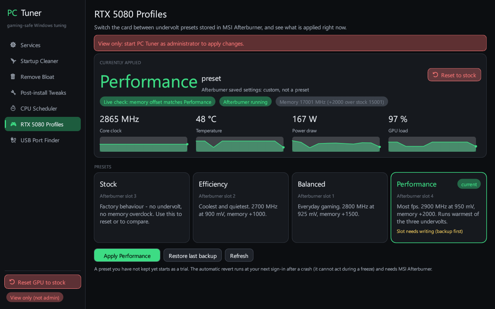
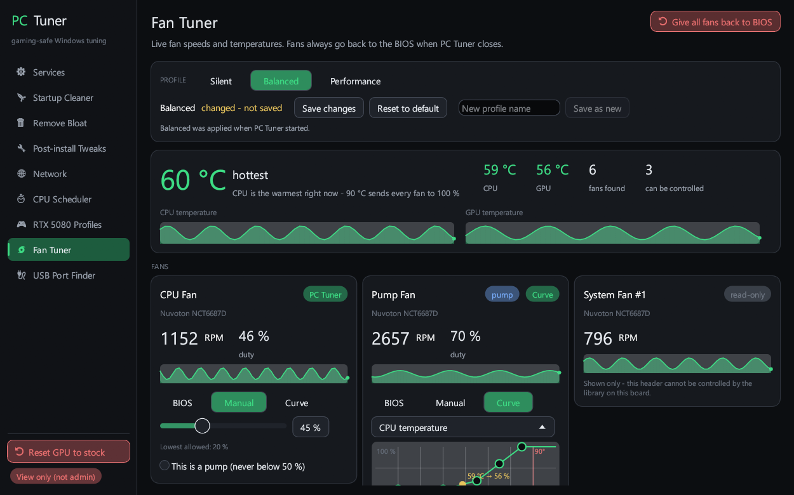
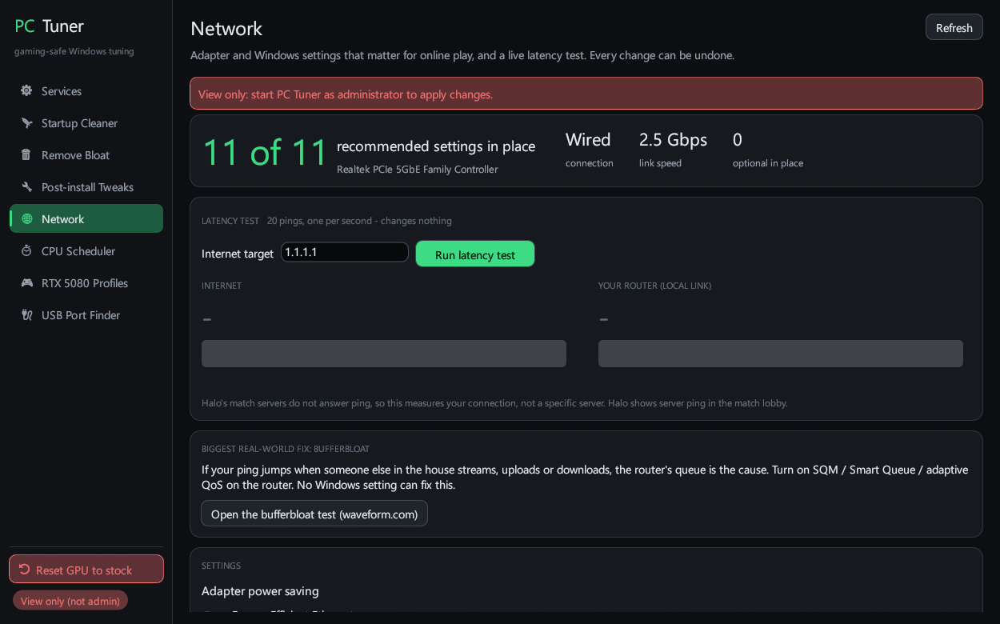
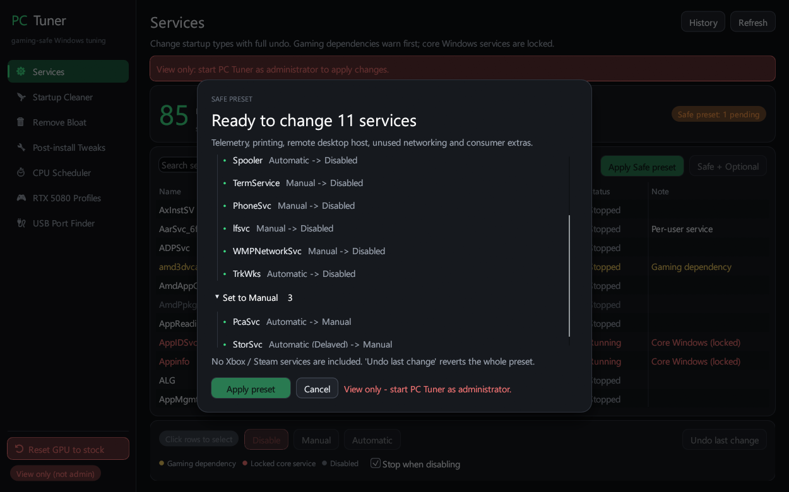

# PC Tuner

A gaming-safe Windows 11 tuning toolkit, built for a Ryzen 7 9800X3D + RTX 5080 gaming PC
that plays Halo Infinite (Xbox app / Game Pass) and Steam games.

Every system change (services, startup, bloat, tweaks, network, performance, CPU scheduler, GPU
profiles) is previewed first, applied with live progress, and can be undone. Fan Tuner changes apply
live and are handed back to the BIOS with BIOS mode or by closing PC Tuner. Anything Xbox,
Game Pass, Steam, Easy Anti-Cheat, the Store or Windows Security depends on is left alone. Edge
stays installed and working: its updater is set to Manual (it still updates itself), its elevation
service is off, and background preloading/autolaunch are turned off. Closing PC Tuner while a
change is being applied waits until it has finished, so the change is recorded and can be undone.



## What is in here

| Folder / file | What it is |
| --- | --- |
| `pctuner/` | **PC Tuner** - one Rust (egui) program with every tool below as a tab |
| `ServiceManager.ps1` | Disable / set to Manual unneeded services, with presets and undo |
| `StartupCleaner.ps1` | Switch off startup junk (Run keys, tasks, Explorer add-ons), never deletes |
| `Remove-Bloat.ps1` | In-depth removal of bundled Store apps, with reinstall blocks and restore |
| `PostInstall-Tweaks.ps1` | Telemetry tasks, Edge preloading, Teredo for Xbox online play; saves the state before the first Apply so `-Undo` puts back exactly that |
| `TweakScheduler.ps1` | Win32PrioritySeparation presets (CPU scheduler) |
| `USB-PortFinder.ps1` | Finds which USB ports sit closest to the CPU |
| `RTX5080/` | MSI Afterburner undervolt presets (Stock / Efficiency / Balanced / Performance) |
| `README.txt` | Full usage notes for every tool |

## PC Tuner tabs

- **Services, Startup Cleaner, Remove Bloat, Post-install Tweaks, CPU Scheduler, USB Port Finder** -
  same rules and safety checks as the scripts.
- **Network** - live ping / jitter / packet-loss test, adapter power saving and latency settings,
  with an honest note on what each one does (most "ping tweaks" are TCP-only; Halo's match traffic is UDP).
- **RTX 5080 Profiles** - live clock / temperature / power / load graphs, presets, an always-visible
  **Reset GPU to stock**, and a safety trial that sends Stock to Afterburner at the next sign-in
  if Windows logs a crash while a new tune is being tested (the check stays until Stock is confirmed).
- **Performance** - evidence-based settings for games and a snappier desktop (flip model for
  windowed DX10/11 games, faster menus, optional taskbar / mouse / power tweaks), read-only checks
  (Game Mode, HAGS, refresh rate, power saving) and a list of popular tweaks left alone because
  they are placebo or harmful.
- **Fan Tuner** - live fan RPM / duty and CPU / GPU / board temperatures; per fan: BIOS, Manual
  (slider) or Curve (draggable points, follows CPU, GPU or the hotter of the two); Silent / Balanced /
  Performance profiles plus your own, the last one applied at startup. Safety: never below 20 %
  (pumps 50 %), 100 % at 90 °C, fans back to the BIOS when PC Tuner closes or crashes, and while
  temperatures cannot be read. Fans are read and driven by PC Tuner itself (Rust, through the PawnIO
  driver and NVAPI): each fan's BIOS settings are saved before it is first driven and put back byte
  for byte; if PC Tuner is force-killed, the next start in the same boot puts them back. Supported:
  the Nuvoton NCT6687D-R board chip (MSI AM5 800-series boards), AMD Zen CPUs and NVIDIA GPUs.
  `PCTUNER_FAN=helper` still runs the older C# helper instead.
- **Sidebar** - **Reset GPU to stock** (always visible) and **Power / BIOS**: restarts straight into
  the UEFI/BIOS setup, or shuts down so the next start opens it, using Windows' own `shutdown /fw`.
  Needs administrator rights and a UEFI-booted PC, and asks for confirmation first. Every open
  program closes immediately without saving, and there is nothing to undo.





Download: get PCTuner.exe from the GitHub Releases page (the exe is not in the repo).

## Build

Needs Rust (rustup, MSVC toolchain), Visual Studio 2022 Build Tools (C++) and, for the old C# fan
helper that is still embedded as a fallback (`PCTUNER_FAN=helper`), the .NET 8 SDK
(`winget install Microsoft.DotNet.SDK.8`). Without the helper build step, PCTuner.exe still builds and
Fan Tuner uses its Rust backend. The fan helper is built first and embedded into PCTuner.exe:

```
cd pctuner
powershell -ExecutionPolicy Bypass -File fanhelper\build.ps1
cargo build --release
```

Fan control at run time needs the [PawnIO](https://pawnio.eu) driver installed (not WinRing0).

The release build asks for administrator rights (it changes system settings). The debug build runs
unelevated in view-only mode. `cargo test` runs the unit tests (use the debug profile).

## Third-party components

The Fan Tuner's helper (`pctuner/fanhelper`) uses, unmodified from NuGet,
[LibreHardwareMonitorLib](https://github.com/LibreHardwareMonitor/LibreHardwareMonitor) 0.9.6
(MPL-2.0; source code at that link) and its dependencies (HidSharp - Apache-2.0, and others listed in
its package). These DLLs are embedded in PCTuner.exe and unpacked to `%LOCALAPPDATA%\PCTuner\fan`.
Hardware access goes through the separately installed [PawnIO](https://pawnio.eu) driver.

The Rust fan backend Fan Tuner uses by default (`pctuner/src/hw`) is ported from LibreHardwareMonitor's
NCT6687D-R, AMD Zen and NVAPI code; those files stay under MPL-2.0 (noted at the top of each). It loads two
signed PawnIO modules, `LpcIO.bin` and `AMDFamily17.bin` (`pctuner/assets/pawnio`, LGPL-2.1, unmodified from
the [PawnIO.Modules](https://github.com/namazso/PawnIO.Modules/releases/tag/0.1.6) 0.1.6 release - the same
bytes LibreHardwareMonitorLib 0.9.6 embeds).

## Disclaimer

These tools change Windows services, the registry, scheduled tasks, network adapter settings,
fan speeds and GPU tuning. They were written for one specific PC. Read the preview before applying anything,
and use at your own risk.
